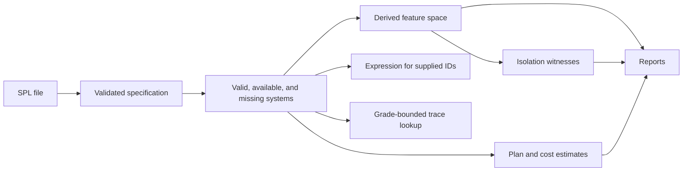

# Feature Isolation requirements

This is the initial project specification, reconstructed from the implementation at commit `1a6305e`, its tests, and its documentation. It defines what the project shall accept, compute, and return. Where those sources disagree, a discrepancy records the difference and an open decision identifies any unresolved intent.

**Requirements** use EARS and retain their existing IDs. **Scenarios** use Given/When/Then to show expected outcomes with concrete inputs. A **discrepancy** identifies code, a test, or documentation that differs from the target. An **open decision** records behavior whose intended outcome needs agreement.

## Responsibilities

| Area | Responsibility |
| --- | --- |
| [CLI and guided mode](cli.md) | Select a command, gather inputs, interpret options, and communicate results and failures. |
| [SPL input](spl.md) | Read and validate a specification with Boolean features, constraints, and system declarations. |
| [System and feature spaces](feature-space.md) | Determine valid, available, and missing systems and identify and classify derived features. |
| [Planning and report admission](planning.md) | Estimate report cost, recommend a scope, and decide whether to start generation. |
| [Reports](reports.md) | Write summaries, detailed feature reports, and isolation-only reports. |
| [Expressions](expressions.md) | Produce a Boolean expression from a supplied set of system IDs. |
| [Traces](traces.md) | Export a grade-bounded lookup from available system IDs to Boolean expressions. |
| [Isolation](isolation.md) | Identify candidate features and system witnesses for a target feature. |
| [Arithmetic and combinations](math.md) | Provide the public arithmetic and combinatorial operations used by the analysis. |
| [Build and verification](verification.md) | Build the tools, run tests, and record current coverage and performance gaps. |

## Flow of information

`guided` collects choices for a command. The diagram shows which information each responsibility uses. The behavior pages define the required results and examples.

## Reading and updating this reference

- Open the repository root as a vault in Obsidian or browse this directory on GitHub. The pages use relative Markdown links and fenced Mermaid diagrams.
- Use an EARS trigger or state where applicable. Name the responsible unit before `shall`, and state a response that a caller can verify. [EARS guide](https://alistairmavin.com/ears/)
- Write scenarios in Markdown. Use **Given** for the starting conditions, **When** for the action, and **Then** for the expected outcome. Use an example table when the same scenario covers several cases. [Given/When/Then reference](https://cucumber.io/docs/gherkin/reference/)
- Use fixture and test links as evidence. Record actual and required outcomes together when they differ, and keep unresolved choices beside the relevant requirements.

## REQ-D01 — Theory reference

The project names `main.pdf` as the external theory authority. The checkout provides paper-aligned examples and tests, but no tracked copy or citation to the paper. A citation would let readers verify the theoretical requirements and resolve discrepancies in the examples. [Theory overview](../../include/mainpage.dox#L6) · [Paper examples](../../include/spl_examples.dox#L27)
